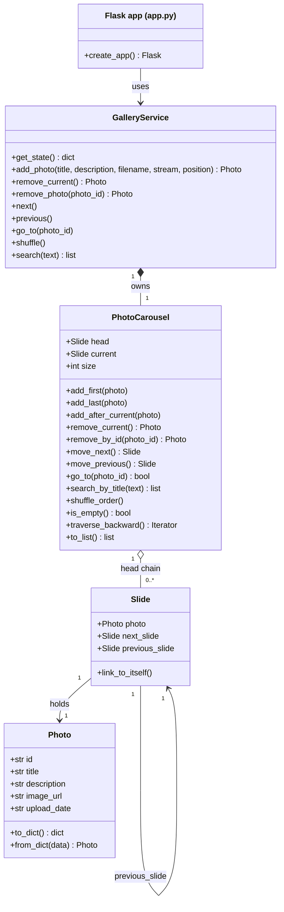

# Circular Photo Gallery

An interactive image carousel whose core data structure is a **doubly circular
linked list**, implemented by hand (no Python lists, `deque` or other built-in
containers store or navigate the slides). It was built for a university data
structures assignment, so the focus is on a clear, correct implementation and
on a live **visualizer** that shows the list working.


*Screenshot placeholder: main viewer with thumbnails and controls.*


*Screenshot placeholder: data structure visualizer.*

## What is a doubly circular linked list?

A linked list is a chain of elements where each element holds a reference to
its neighbours instead of living at an index.

* **Doubly linked**: every element stores a reference to the element **after**
  it (`next_slide`) and to the element **before** it (`previous_slide`), so the
  list can be walked in both directions.
* **Circular**: there is no `None` at the ends. The last element's `next_slide`
  points back to the first one (`head`), and `head.previous_slide` points to the
  last one (the *tail*). A list with a single element points to itself.

```
        +---------------------------------------------+
        v                                             |
      [head] <--> [slide 2] <--> [slide 3] <--> [tail]
        |                                             ^
        +---------------------------------------------+
```

### Why it fits a carousel

* Pressing **Next** on the last photo must show the first one, and **Previous**
  on the first photo must show the last one. In a circular list this needs no
  `if` or modulo: you just follow `next_slide` / `previous_slide`.
* Going forward and backward are equally cheap (O(1)) thanks to the two links.
* Inserting or removing a slide next to the current one is O(1): only a few
  references are rewritten, nothing is shifted like in an array.
* Autoplay can run in either direction forever without special cases.

### Complexity

| Operation | Cost |
|-----------|------|
| `add_first`, `add_last`, `add_after_current` | O(1) |
| `remove_current` | O(1) |
| `remove_by_id`, `go_to`, `search_by_title` | O(n) (one lap) |
| `move_next`, `move_previous` | O(1) |
| `shuffle_order` | O(n²) (re-inserts each slide at a random place) |

## Class diagram



## Project structure

```
circular_photo_gallery/
  app.py                    Flask routes and JSON REST API
  gallery/
    photo.py                Photo (data only)
    slide.py                Slide (list element with next/previous links)
    photo_carousel.py       PhotoCarousel (the doubly circular linked list)
    gallery_service.py      Validation, file handling, JSON persistence
    sample_images.py        Pillow placeholder image generator
  templates/index.html
  static/css/style.css
  static/js/app.js          Viewer, thumbnails, autoplay, API calls
  static/js/visualizer.js   SVG visualizer with animations
  static/uploads/           Sample and uploaded images
  data/gallery.json         Persisted order, metadata and current slide
  tests/                    pytest suite
  requirements.txt
```

## Install and run

Requires Python 3.9 or newer.

```bash
cd circular_photo_gallery
python -m venv .venv
.venv\Scripts\activate        # Windows (macOS/Linux: source .venv/bin/activate)
pip install -r requirements.txt
python app.py
```

Open <http://127.0.0.1:5001>. On the first run the app generates 8 placeholder
images with Pillow and creates `data/gallery.json`. To start from scratch,
delete `data/gallery.json` and restart.

### Run the tests

```bash
python -m pytest
```

The suite covers every `PhotoCarousel` operation (empty list, a single slide,
removing the head or the current slide, wrap-around in both directions,
`head.previous_slide` being the tail, shuffling by relinking), plus a
randomized test that checks the circular invariants after hundreds of mixed
operations, and tests for the service and the REST API.

## Using the app

* **Viewer**: *Previous* / *Next* buttons, left and right arrow keys, and a
  counter such as `3 / 8`.
* **Autoplay**: play/pause, a forward/backward direction toggle and a speed
  selector.
* **Thumbnails**: the active slide is highlighted; click one to jump to it.
* **Add a photo**: choose where it is inserted: first, last, or after the
  current photo.
* **Delete current**, **Shuffle** (relinks the slides) and **Search by title**.
* **Visualizer**: slides are drawn as boxes on a circle. Blue arrows are
  `next_slide`, orange arrows are `previous_slide`. `HEAD`, `CURRENT` and
  `TAIL` tags mark the special slides, and the table under the diagram shows
  the neighbours of the current slide. Insertions, removals, shuffles and
  navigation are animated. Click a box to jump to that slide.

## REST API

| Method | Endpoint | Description |
|--------|----------|-------------|
| GET | `/api/carousel` | Full state: slides with `previous_id` / `next_id`, `head_id`, `tail_id`, `current_id`, `position` |
| POST | `/api/slides` | Multipart form: `title`, `description`, `position` (`first`, `last`, `after_current`), `image` |
| DELETE | `/api/slides/<id>` | Remove a slide by photo id |
| DELETE | `/api/slides/current` | Remove the current slide |
| POST | `/api/navigate/next` | Move forward (wraps around) |
| POST | `/api/navigate/previous` | Move backward (wraps around) |
| POST | `/api/navigate/goto/<id>` | Jump to a photo |
| POST | `/api/shuffle` | Shuffle by relinking |
| GET | `/api/search?q=text` | Search photos by title |

Mutating endpoints return `{"message": "...", "state": {...}}`. Errors return
`{"error": "..."}` with status 400 (validation) or 404 (not found).

## Implementation notes

* Slides are only reachable by following links from `head`. Python lists are
  used solely to return data (`to_list`, `search_by_title`) or to read and
  write JSON.
* `shuffle_order` opens the circle into a chain and re-inserts every slide at a
  random position. Slide and photo objects are never copied; only their
  `next_slide` / `previous_slide` references change.
* After a removal, `head` and `current` are repaired: if the removed slide was
  either of them, the pointer moves to the following slide.
* `GalleryService` saves to JSON after every change (including navigation) and
  rebuilds the list on startup by calling `add_last` in the stored order.
